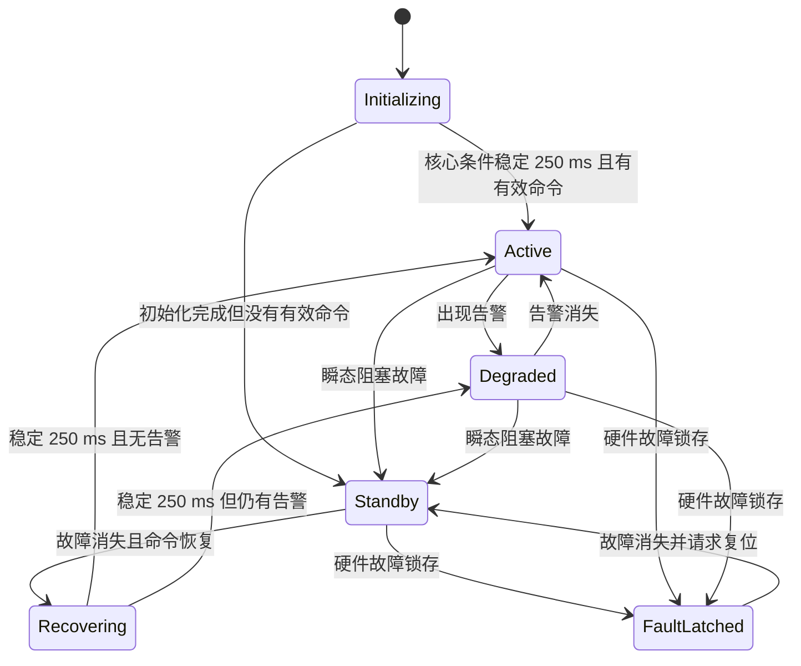

# 安全与故障状态机

本文说明 `LuojiaFox` 安全状态机的职责、状态转换、故障分类、底盘接入方式和调试方法。

## 1. 模块定位

`Detect` 负责回答“某个设备是否在线、数据是否异常”，安全状态机负责回答：

1. 当前整车是否允许运动。
2. 哪些功能需要降级。
3. 故障消失后能否自动恢复。
4. 必须停机锁存还是允许人工复位。
5. 当前允许输出多少比例的控制量。

因此两者不是重复模块：

```text
设备驱动 / 数据回调
        ↓
Detect：超时、数据有效性、接收频率
        ↓
SafetyStateMachine：故障分级、状态转换、输出许可
        ↓
底盘 / 云台 / 发射机构执行层
```

安全状态机本身不访问 HAL，可在主机侧注入输入进行测试。

## 2. 文件

| 文件 | 职责 |
|---|---|
| `safety_state.hpp` | 状态、故障位、输入输出数据和状态机接口 |
| `safety_state.cpp` | 状态转换、故障锁存、过温恢复和输出缩放 |
| [自动化测试](../../../tests/safety_state_test.cpp) | 上电、掉线恢复、故障锁存、过温和模式降级测试 |

应用接入位置：

- [底盘应用](../../4_Application/Chassis/app_chassis.cpp)
- [底盘参数](../../4_Application/Chassis/chassis_config.hpp)
- [轮电机反馈](../../4_Application/Chassis/chassis_controller.cpp)
- [设备检测](../Detect/detect.h)

## 3. 状态

| 状态 | 含义 | 底盘输出 |
|---|---|---|
| `Initializing` | 等待 IMU、轮反馈、控制链等核心条件稳定 | 禁止 |
| `Active` | 核心条件正常且没有告警 | 允许 |
| `Degraded` | 核心条件安全，但存在非致命告警 | 按 `command_scale` 允许 |
| `Recovering` | 瞬态故障消失，稳定观察中 | 禁止 |
| `Standby` | 无有效命令、轮反馈、速度估计或控制链异常 | 禁止 |
| `FaultLatched` | 急停、轮驱故障或 CAN Bus-off 已锁存 | 禁止 |

状态转换：



`Initializing` 只等待感知和控制链，不要求操作手已经给出运动命令。如果上电时拨杆处于禁用车，初始化完成后进入 `Standby`。

## 4. 输入

| 输入 | 来源 | 作用 |
|---|---|---|
| `command_ready` | 底盘命令选择器 | 当前命令在线、新鲜且数值有效 |
| `auto_mode` | 底盘模式 | 决定 IMU 和加速度是否属于硬性条件 |
| `imu_online` | `Detect` | IMU 数据按期更新，且没有数据异常 |
| `acceleration_valid` | INS | 去重力线性加速度可用于运动估计 |
| `all_wheels_online` | 电机反馈 + `Detect` | 四轮反馈按期更新且通过稳定观察 |
| `velocity_estimate_valid` | 轮速/IMU 融合 | 速度反馈可用于闭环 |
| `control_chain_valid` | 力分配和功率管理 | 力矩阵及功率管理已初始化 |
| `can_bus_healthy` | BSP CAN 统计 | CAN 未处于 Bus-off 或恢复过程 |
| `board_link_online` | 双板通信 | 对端在链路超时时间内发送过有效帧 |
| `referee_online` | 裁判系统 | 提供动态功率和缓冲能量数据 |
| `supercap_available` | 超级电容应用 | 超电可用，或本项目没有配置超电 |
| `wheel_driver_fault_mask` | DJI 电机反馈 | 每轮驱动故障码 |
| `wheel_temperature_warning_mask` | 轮电机反馈 | 达到过温告警阈值 |
| `wheel_temperature_critical_mask` | 轮电机反馈 | 达到过温封锁阈值 |
| `emergency_stop` | 上层/硬件急停接口 | 立即锁存并禁止输出 |

底盘每周期先更新 `Detect`：

```text
RC 数据有效       -> detect_hook(DETECT_RC)
轮电机反馈有效    -> detect_hook(DETECT_WHEEL1..4)
BMI088 陀螺有效   -> detect_hook(DETECT_BMI_GYRO)
BMI088 加速度有效 -> detect_hook(DETECT_BMI_ACCEL)
```

随后通过 `detectGetErrorMask()` 汇总检测结果。

## 5. 输出

| 输出 | 含义 |
|---|---|
| `state` | 当前安全状态 |
| `active_faults` | 本周期阻塞故障、告警和锁存故障的并集 |
| `latched_faults` | 必须请求复位才能清除的故障 |
| `warnings` | 不直接阻塞底盘，但会使状态进入 `Degraded` |
| `chassis_output_allowed` | 底盘是否允许生成驱动输出 |
| `auto_mode_allowed` | 自动模式是否具备有效 IMU 和线性加速度 |
| `command_scale` | 最终电流缩放系数，范围 `0.0 ~ 1.0` |
| `state_changed` | 本周期是否发生状态变化 |
| `state_since_ms` | 当前状态开始时间 |

底盘调用顺序：

```text
读取系统状态
  -> 选择控制模式和命令
  -> 读取电机/IMU反馈
  -> 更新 Detect
  -> 更新 SafetyStateMachine
  -> 检查 chassis_output_allowed
  -> 速度闭环和力分配
  -> 乘以 command_scale
  -> 功率管理
  -> CAN 发送
```

安全许可位于闭环和 CAN 发送之前，因此状态机禁止输出时不会继续积累 PID 积分。

## 6. 故障位与策略

| 故障位 | 分类 | 行为 |
|---|---|---|
| `kCommandUnavailable` | 阻塞 | 进入 `Standby`，无命令时禁止输出 |
| `kImuUnavailable` | 条件阻塞 | 自动模式禁止输出；直接遥控降级为轮速模式 |
| `kAccelerationUnavailable` | 条件阻塞 | 自动模式禁止输出；直接遥控进入告警 |
| `kWheelOffline` | 阻塞 | 进入 `Standby` |
| `kWheelDriverFault` | 锁存 | 进入 `FaultLatched` |
| `kWheelOvertemperature` | 热锁存 | 停车，温度降至告警阈值以下并稳定后自动恢复 |
| `kWheelTemperatureWarning` | 告警 | 进入 `Degraded`，电流缩放到 65% |
| `kVelocityEstimateInvalid` | 阻塞 | 进入 `Standby` |
| `kControlChainInvalid` | 阻塞 | 力矩阵或功率管理不可用时禁止输出 |
| `kCanBusFault` | 锁存 | Bus-off 或恢复过程中禁止输出 |
| `kEmergencyStop` | 锁存 | 进入 `FaultLatched` |
| `kBoardLinkOffline` | 告警 | 进入 `Degraded` |
| `kRefereeOffline` | 告警 | 进入 `Degraded`，功率管理使用回退策略 |
| `kSupercapUnavailable` | 告警 | 进入 `Degraded`，不依赖超电继续运行 |

如果 `SUPERCAP_NOT_CONFIGURED`，安全状态机将超电视为“本车未配置”，不会持续产生超电告警。

## 7. 时间与降级参数

| 参数 | 当前值 | 位置 |
|---|---:|---|
| 初始化稳定时间 | 250 ms | `safety_state.cpp` |
| 瞬态故障恢复时间 | 250 ms | `safety_state.cpp` |
| 过温解除稳定时间 | 1500 ms | `safety_state.cpp` |
| 过温告警阈值 | 75 ℃ | `chassis_config.hpp` |
| 过温临界阈值 | 90 ℃ | `chassis_config.hpp` |
| 告警电流比例 | 65% | `safety_state.cpp` |
| 无 IMU 直接遥控比例 | 80% | `safety_state.cpp` |

这些数值是软件初始值，不是实车安全认证结果。正式比赛前必须结合电机温升、轮速波形、
地面附着和实际负载重新确认。

## 8. 锁存与复位

以下故障不会因为数据恢复而自动解除：

- 电机驱动故障码
- CAN Bus-off
- 急停

硬件故障消失后调用：

```cpp
const bool accepted =
    safety::g_safety.requestReset(HAL_GetTick());
```

`requestReset()` 仍会检查当前输入：

- 急停必须已释放。
- 轮驱故障码必须消失。
- CAN 不能处于 Bus-off。
- 轮温必须低于告警阈值。

复位成功后进入 `Standby`，随后需要完整经过 `Recovering` 稳定时间。

当前工程尚未把复位操作绑定到按键或 USB 命令，也没有硬件急停输入。在完成对应接口前，
锁存故障可通过断电重启恢复。

## 9. 调试

在调试器中展开 `safety::g_safety`：

```text
state
active_faults
latched_faults
warnings
chassis_output_allowed
auto_mode_allowed
command_scale
state_since_ms
```

同时检查：

- `g_chassisController.latest_feedback.driver_fault_mask`
- `g_chassisController.latest_feedback.temperature_c`
- `g_chassisController.latest_feedback.temperature_warning_mask`
- `g_chassisController.latest_feedback.temperature_critical_mask`
- `detectGetErrorMask()`
- BSP CAN 统计中的 `bus_off`、`recovering` 和 `tx_failed`

故障位是 `uint32_t` 位图，可以使用十六进制直接记录到日志。

## 10. 验证

主机测试：

```powershell
cd RM2027-LFTemplate
g++ -std=c++14 `
  -I RM2027-LFCore/3_LuojiaFox/Safety `
  tests/safety_state_test.cpp `
  RM2027-LFCore/3_LuojiaFox/Safety/safety_state.cpp `
  -o build/safety_state_test.exe

.\build\safety_state_test.exe
```

测试覆盖：

- 初始化稳定时间和无命令启动
- 瞬态掉线后的 `Standby -> Recovering -> Active`
- 轮驱故障锁存和人工复位
- 过温告警、临界过温与热恢复
- 自动模式缺少 IMU 或加速度时禁止输出
- 直接遥控无 IMU 时降级运行

固件验证：

```powershell
mingw32-make board-chassis -j4
mingw32-make board-gimbal -j4
```

## 11. 扩展约定

- `Detect` 只提供设备健康事实，不要直接把设备状态写成整车输出许可。
- 状态机只做安全决策，不发送 CAN，不执行 PID，不访问硬件寄存器。
- 新执行机构应读取安全快照，不应绕过 `chassis_output_allowed`。
- CAN 接收中断只记录事实或时间戳，安全状态更新应在任务上下文执行。
- 新增硬性故障时，应明确它属于阻塞、锁存还是告警。
- 新增告警时必须定义迟滞或恢复条件，避免状态和输出比例抖动。
- 变更阈值、状态或输出行为时，必须同步增加主机测试。
